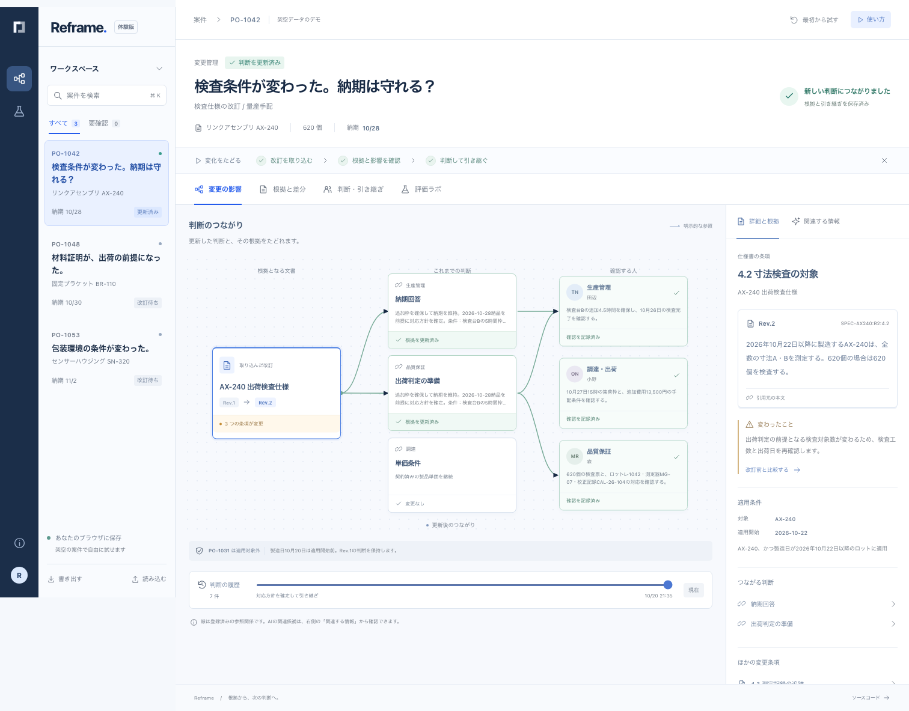

# Reframe

**変更を、次の判断へ。**

[Reframe](https://reframe.2-38.com) は、仕様や条件が変わったとき、以前の判断・根拠・確認作業・引き継ぎをつなぎ直す業務ワークスペースです。

架空の注文 `PO-1042` を例に、承認済みの仕様書 `Rev.1` から `Rev.2` へ変わった後、誰が何を再確認し、どの回答を更新する必要があるかを一続きで試せます。



## 試せること

1. 改訂を取り込み、影響する判断と対象外の注文を分けて確認する。
2. 条項の旧版・新版を比較し、引用元からつながる判断へ戻る。
3. 過去案件や手順をBM25、学習済みモデル、未学習の埋め込みで検索する。
4. 生産・調達・品質の担当が確認した後に、対応案を選ぶ。
5. 対応案を変えると確認をやり直し、最後に人が判断を更新する。
6. 古い判断を残したまま新しい回答を追加し、変更履歴と引き継ぎを書き出す。
7. 評価ラボで、実際の学習・保持テスト結果と失敗例を確認する。

3つの架空案件と作業状態はブラウザ内に保存されます。同じ案件を最初から試しても、ほかの案件の操作は残ります。画面からJSONへ書き出し、読み戻すこともできます。

## 仕組み

- **UI / 業務エンジン:** React、TypeScript。文書の適用日・製品範囲、担当確認、承認条件、判断履歴を通常のコードで処理します。
- **学習:** Python、PyTorch。日本語の文字n-gramを入力する小さな共有エンコーダを、自作の関連文書データで学習します。
- **ブラウザ推論:** PyTorchからONNXへ書き出し、ONNX Runtime WebのCPU WASMで実行します。モデルとWASMは同一オリジンから配信します。
- **説明生成:** 任意の「根拠を整理する」操作だけがCloudflare Workers AIを呼びます。利用できない場合は引用文の抜粋へ戻ります。
- **公開:** Cloudflare Workersの静的AssetsとAPI、Durable Objectによる全体の日次利用上限、Rate Limiting binding。

モデルの類似度は「関連候補を読む順序」にだけ使います。文書の適用可否、数量・日付、承認、出荷可否は決めません。

## 学習と評価

自己作成の架空データを、シナリオ系列単位で学習160問・検証32問・保持テスト48問に分けています。モデルは270,336パラメータ、各手法は同じ18候補を並べ替えます。

| 手法 | nDCG@5 | Recall@5 | MRR | Top-1 |
| --- | ---: | ---: | ---: | ---: |
| 文字n-gram BM25 | **0.875** | **0.875** | **1.000** | **1.000** |
| 固定した未学習のランダム射影 | 0.399 | 0.424 | 0.613 | 0.479 |
| PyTorch学習済みエンコーダ | 0.608 | 0.667 | 0.716 | 0.583 |

この保持テストではBM25が学習済みモデルを上回りました。その結果も隠さず公開し、製品の既定値にはBM25を使っています。データは単一作者による合成データで、実組織への精度や事前学習済み検索モデルへの優位性を示すものではありません。

PyTorchとONNX Runtimeの出力差は最大 `8.94e-8`、許容差は `1e-5` です。データの作成方法、分割監査、学習ログ、全クエリの順位、失敗分析、モデルカードもリポジトリに含めています。

- [モデルカード](ml/MODEL_CARD.md)
- [データセットカード](ml/DATASET.md)
- [失敗分析](ml/ERROR_ANALYSIS.md)
- [評価結果](public/evaluation/metrics.json)

## 再現

Node.js 24以上とPython 3.12を使います。

```bash
npm ci
npm run check
npm test
npm run build
```

ブラウザを操作したE2Eは、ビルド済みWorkerを起動してから実行します。

```bash
npm run preview
npm run test:e2e
```

PyTorchの学習・書き出し・評価は再実行できます。

```bash
uv venv --python 3.12 .venv
uv pip sync --python .venv/bin/python ml/requirements.lock.txt
.venv/bin/python ml/train.py
.venv/bin/python -m unittest discover -s tests -p 'ml*_test.py' -v
uv pip check --python .venv/bin/python
```

学習は外部モデルや外部APIをダウンロードせず、記録済みの環境で数秒で完走します。正確な依存バージョンはロックファイルにあります。

## セキュリティと制約

説明APIは本文サイズ、文字数、根拠数、Content-Type、同一オリジンを検証します。生成結果に未知の引用IDが含まれる場合やタイムアウトした場合は、言語モデル出力を採用せず引用文へ戻ります。APIはIP単位のレート制限と全体の日次予算を持ち、質問や根拠をDurable Objectへ保存しません。

デモ、案件、仕様書、人物名はすべて架空です。実在する組織の記録や業務手順は含みません。公開版は実際の業務判断、安全、品質保証、自動発注に使用する製品ではありません。

依存関係と第三者ライセンスは [THIRD-PARTY-NOTICES.md](THIRD-PARTY-NOTICES.md) に記載しています。このリポジトリの自作コードと架空シナリオは [MIT License](LICENSE) です。
